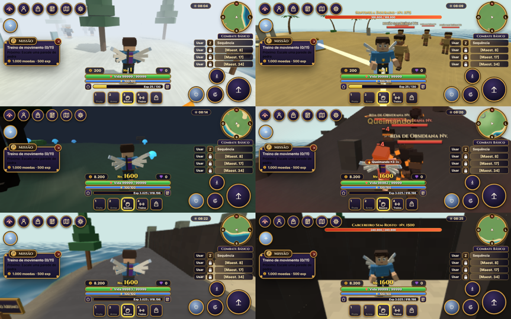

# 02 — Mundo e ilhas

> O mundo segue a **estrutura de progressão** de RPGs piratas do gênero (três mares com
> faixas de nível crescentes, ilhas por bioma, chefes por região), mas **todas as ilhas são
> originais**. A lista abaixo é o inventário oficial deste projeto; nenhuma ilha conta como
> "feita" até passar pelo checklist da seção 8.

## 1. Estrutura dos mares

| Mar | Níveis | Tamanho aproximado | Acesso |
|---|---|---|---|
| Primeiro Mar | 1–700 | 6 × 6 km | Início do jogo |
| Segundo Mar | 700–1500 | 8 × 8 km | Derrotar o chefe do Portão das Correntes e obter a Carta Náutica |
| Terceiro Mar | 1500–2400 | 10 × 10 km | Derrotar a Guardiã da Fenda Celeste |

Entre os mares há uma **travessia** (viagem marítima curta com evento de tempestade) e,
depois de liberado, um teleporte por porto.

## 2. Inventário de ilhas

### Primeiro Mar

| # | Ilha | Níveis | Bioma | Destaques | Chefe |
|---|---|---|---|---|---|
| 1 | Ilha da Âncora | 1–25 | Tropical | Vila inicial, porto, mestre de missões, Roleta de Frutas | Capitão Ferrugem |
| 2 | Praia dos Saqueadores | 25–75 | Praia e mangue | Acampamento pirata, grutas costeiras | Rainha das Conchas |
| 3 | Bosque Sussurrante | 75–150 | Floresta densa | Árvores gigantes, pontes suspensas, ruínas | Guardião de Musgo |
| 4 | Duna Partida | 150–225 | Deserto | Cidade de arenito, cânions, tempestades de areia | Escorpião de Bronze |
| 5 | Forte Maré-Alta | 225–300 | Base militar | Quartel, prisão, muralhas, estaleiro | Comandante Lâmina-Azul |
| 6 | Pico Gélido | 300–400 | Montanha nevada | Lagos congelados, cavernas de gelo, teleférico | Urso de Cristal |
| 7 | Porto das Lanternas | 400–475 | Cidade portuária | Mercado, tavernas, arena clandestina | Duelista Mascarado |
| 8 | Caldeira Rubra | 475–575 | Vulcânica | Rios de lava, forjas, tremores | Ferreiro da Lava |
| 9 | Arena do Coliseu Partido | 575–650 | Arena | Torneio por ondas, desafios de combo | Campeão Imbatível |
| 10 | Fenda Celeste | 650–700 | Ilhas flutuantes | Plataformas no céu, correntes de vento | Guardiã da Fenda Celeste (acesso ao 2º Mar) |

#### Situação no jogo (atualização 14)

As ilhas 2 a 10 já existem no jogo em volta da Ilha de Treino (que fica como ilha de tutorial,
Nv. 1–10) e do **Porto das Origens**, que faz o papel da Ilha da Âncora (Nv. 1–25). Por enquanto
o mar é compacto (cerca de 2 × 1,6 km) para caber no orçamento do celular; o tamanho da tabela
acima é o alvo final.

| Ilha | Centro (x, z) | Raio | O que tem hoje |
|---|---|---|---|
| Praia dos Saqueadores | (700, −280) | 60 | Coqueiros na orla, tendas do acampamento, casco de navio encalhado |
| Bosque Sussurrante | (1000, 120) | 64 | Relevo ondulado, 46 árvores grandes, arbustos e anel de ruínas de pedra |
| Duna Partida | (760, 540) | 66 | Dunas em ondas, cactos e ruínas de arenito |
| Forte Maré-Alta | (320, 800) | 58 | Muralha quadrada com torres e portão voltado para a praia de chegada |
| Pico Gélido | (−180, 760) | 64 | Montanha de ~34 com neve no alto e pinheiros claros |
| Porto das Lanternas | (−600, 440) | 62 | Mini cidade gerada pela semente (casas e ruas) com cais |
| Caldeira Rubra | (−780, −60) | 64 | Vulcão com cratera, **lago de lava** (queima ao pisar), rochas escuras e forjas |
| Arena do Coliseu Partido | (−520, −560) | 56 | Anel de arquibancadas em ruínas com o chefe no centro |
| Fenda Celeste | (−40, −780) | 50 | Plataformas flutuantes sobre a ilha |

- **Relevo:** procedural por semente; costa irregular; a borda submersa é íngreme (perto da
  praia o fundo cai para −13), assim o bote encosta perto da areia.
- **Chegada:** cada ilha tem uma praia voltada para a Ilha de Treino com uma placa
  (`Nv. a–b · Chefe: nome`); ao entrar aparece o aviso pequeno no topo com nome e faixa.
- **Inimigos por nível:** 4 por ilha no acampamento, com níveis espalhados pela faixa; vida,
  dano, defesa, experiência e moedas crescem com o nível (`scaledDef`). Os de gelo, fogo e
  raio aplicam a condição do elemento.
- **Chefes:** um por ilha no nível do topo da faixa (`bossDef`): corpo 1,55×, 10× a vida,
  +40% de dano, 10× experiência e moedas, golpe marcado no chão 40% maior, renasce em 5 min.
  Barra de chefe no topo da tela a até 40 de distância. Recompensa: material raro (2–4), um
  item de equipamento, chave da roleta (sempre na primeira vez, depois 25%) e 15% de chance
  de uma fruta.
- **Porto das Origens:** acampamento de Saqueadores do Porto (Nv. 8, 12 e 16) e o chefe
  **Capitão Ferrugem** (Nv. 25).
- **Mapa:** o botão **Carta do mar** mostra todas as ilhas com nome e faixa, o bote e o
  jogador; no mar aberto o mapa já abre na carta.
- **Ainda não:** grutas, pontes suspensas, teleférico, tempestades de areia, interiores,
  missões e atividades próprias de cada ilha (checklist da seção 8).

### Segundo Mar

| # | Ilha | Níveis | Bioma | Destaques | Chefe |
|---|---|---|---|---|---|
| 11 | Cais das Correntes | 700–775 | Cidade portuária grande | Hub do mar, estaleiro de caravelas | Contramestre Corrente |
| 12 | Arquipélago Esmeralda | 775–875 | Selva e cachoeiras | Rios navegáveis, templos submersos | Serpente-Raiz |
| 13 | Cidadela de Granito | 875–975 | Fortaleza gigante | Muralhas em camadas, catapultas, interiores | General Basalto |
| 14 | Geleira Silente | 975–1075 | Território congelado | Navios presos no gelo, nevascas | Rainha do Inverno Eterno |
| 15 | Ruínas do Sol Poente | 1075–1175 | Ruínas antigas | Quebra-cabeças de luz, câmaras secretas | Sentinela Dourado |
| 16 | Ilha do Bosque Noturno | 1175–1275 | Floresta misteriosa | Névoa, cogumelos luminosos, ilusões | Senhora das Sombras |
| 17 | Bastião Vulcânico | 1275–1375 | Vulcão ativo | Erupções programadas, cavernas de magma | Titã de Obsidiana |
| 18 | Masmorra do Abismo | 1375–1500 | Masmorra | Andares com chaves, armadilhas | Carcereiro Sem-Rosto (acesso ao 3º Mar) |

#### Situação no jogo (atualização 17)

- **Onde fica:** ao norte do Primeiro Mar (z ≈ −2300 a −2850). A carta do mapa mostra só o mar
  onde o jogador está ("Carta do Segundo Mar").
- **Travessia:** o **Portão das Correntes** (boias douradas ao norte da Fenda Celeste) só deixa
  passar depois de derrotar a Guardiã da Fenda Celeste; antes disso a corrente empurra o bote
  de volta. Ao entrar no portão começa a **tempestade** (22 s): chuva, céu escuro, ondas 2,6×
  maiores e relâmpagos. A corrente leva o bote; o analógico só desvia para os lados. Cada raio
  marca um círculo amarelo na água onde o bote vai passar e cai 1 s depois: acertar o bote
  tira 7% do casco e dá Choque. Não dá para descer no meio. No fim o bote sai ao sul do Cais
  das Correntes. Primeira travessia: +500 de experiência.
- **Volta:** o **Portão do Sul** (12 s de tempestade) leva de volta ao Portão das Correntes; ou
  o **Barqueiro das Correntes** leva ao Porto das Origens. Depois da primeira travessia a
  Barqueira do Porto também leva ao Cais das Correntes.
- **Ilhas prontas:** Cais das Correntes (vila maior com estaleiro e cascos em construção;
  Contramestre Corrente, Nv. 775), Arquipélago Esmeralda (selva com morro, cachoeira e templo em
  ruínas; Serpente-Raiz, Nv. 875) e Cidadela de Granito (duas muralhas, torre de menagem e
  catapultas; General Basalto, Nv. 975). Cada uma com acampamento de 4 inimigos do nível e um
  navio corsário (Maré Traiçoeira, Cipó Negro, Punho de Granito).
- **Ainda não:** caravelas no estaleiro, rios navegáveis e interiores.

#### Situação no jogo (atualização 27): Segundo Mar completo

| Ilha | Centro (x, z) | Raio | O que tem |
|---|---|---|---|
| Geleira Silente | (−820, −2480) | 70 | Placa de gelo, três navios presos no gelo, espinhos de gelo e **fogueiras** (uma em cada naufrágio e uma na praia de chegada) |
| Ruínas do Sol Poente | (820, −2440) | 64 | Pilar do sol no meio, **quatro espelhos** e a **câmara secreta**, colunas quebradas |
| Ilha do Bosque Noturno | (780, −3020) | 66 | Floresta escura, 46 **cogumelos luminosos**, **névoa** fechada e cinco **ecos ilusórios** |
| Bastião Vulcânico | (−780, −3040) | 68 | Vulcão com cratera de lava, duas **cavernas de magma** (arco de rocha sobre poça de lava) e **erupções** |
| Masmorra do Abismo | (0, −3220) | 62 | Quatro muralhas quadradas, portas de grade, **três chaves**, **espinhos** e a cela do Carcereiro no meio |

- **Nevasca (Geleira):** a cada 45 s vem uma nevasca de 18 s (aviso 4 s antes; a neblina fecha).
  O frio sobe 7/s na nevasca, cai 5/s fora dela e 30/s perto de uma fogueira (raio 6). Frio
  cheio: lento e 2% da vida a cada 2 s. Fruta da Geada com maestria da imunidade não sente.
- **Quebra-cabeça de luz (Ruínas):** o pilar do sol manda a luz para o espelho 1, que passa
  para o 2, e assim até o altar dentro da câmara. Cada espelho gira 90° pelo botão de ação
  ("Girar espelho"); só gira o espelho a que a luz já chega. Os quatro certos abrem a porta da
  câmara e o baú (8.000 moedas, 2 chaves da roleta, Cristal Marinho, Pérolas, um item e 3.000 de
  experiência). Uma vez por salvo; fica resolvido ao recarregar.
- **Ecos ilusórios (Bosque Noturno):** vultos roxos que vagam. Golpear um eco com a Percepção
  ligada desfaz o eco e dá 3 de Haki da Observação (até 30 por visita); sem ela, é uma ilusão
  e deixa lento por 2 s. Voltam depois de 60 s.
- **Erupções (Bastião):** a cada 30 s o vulcão treme (aviso 5 s antes) e entra em erupção por 6 s:
  12 rochas caem em volta da cratera, cada uma com círculo laranja 1,3 s antes. Acerto: 8% da
  vida e queimadura. A lava da cratera e das cavernas queima quem pisa (a Brasa com a maestria
  da imunidade não queima).
- **Masmorra:** a porta de fora está aberta; cada andar tem um altar com uma chave (Bronze,
  Prata, Ouro), pega pelo botão de ação e em ordem. Cada chave abre a grade do andar seguinte
  (portas em lados alternados: é preciso dar a volta). Espinhos sobem por 1,2 s a cada 3 s, com
  aviso vermelho antes: 6% da vida. O Carcereiro Sem-Rosto e os guardas só saem do lugar com o
  jogador perto (não atravessam as muralhas). As chaves ficam salvas.
- **Chefes:** Rainha do Inverno Eterno (gelo, Nv. 1075), Sentinela Dourado (raio, Nv. 1175),
  Senhora das Sombras (Nv. 1275), Titã de Obsidiana (fogo, Nv. 1375) e Carcereiro Sem-Rosto
  (Nv. 1500). Cada ilha tem um navio corsário (Presa do Inverno, Vela do Poente, Mortalha
  Noturna, Brasa de Obsidiana, Grilhão do Abismo).
- **Portão do Abismo:** ao norte da Masmorra (0, −3420). Só deixa passar depois de derrotar o
  Carcereiro Sem-Rosto; a tempestade leva ao **Terceiro Mar** (chegada em (0, −4310); primeira
  travessia: +1.500 de experiência). O **Portão do Horizonte** traz de volta. A carta mostra o
  "Terceiro Mar" (por enquanto só o portão; as ilhas 19 a 25 vêm na atualização 28).

### Terceiro Mar

| # | Ilha | Níveis | Bioma | Destaques | Chefe |
|---|---|---|---|---|---|
| 19 | Capital dos Mil Mastros | 1500–1600 | Metrópole | Distritos, castelo, docas militares | Almirante Mil-Velas |
| 20 | Santuário das Escamas | 1600–1725 | Criaturas míticas | Ninhos de dragões, pontes de pedra | Dragão Ancião |
| 21 | Ilha da Tempestade Eterna | 1725–1850 | Tempestade | Raios constantes, para-raios gigantes | Senhor dos Trovões |
| 22 | Fortaleza do Horizonte | 1850–1975 | Fortaleza de alto nível | Andares de cerco, canhões gigantes | Marechal do Horizonte |
| 23 | Mar dos Ossos | 1975–2100 | Oceano de tempestade | Naufrágios, bestas marinhas, ilhotas | Leviatã Ósseo (chefe oceânico) |
| 24 | Templo da Aurora | 2100–2250 | Monumento celeste | Arquitetura colossal, provas de mobilidade | Avatar da Aurora |
| 25 | Ilha Oculta | 2250–2400 | Secreta | Só aparece no mapa após um enigma | Soberano Esquecido (chefe mundial) |

Eventos raros do Terceiro Mar: Lua de Sangue (inimigos fortalecidos e loot raro),
Navio Fantasma (navio errante com tesouro) e Maré Celeste (ilhas flutuantes temporárias).

## 3. Terrenos

Base: o terreno voxel quadriculado do HTML original. A estética se mantém; a geração e o
acabamento são refeitos.

### 3.1 Geração

| Etapa | Descrição |
|---|---|
| Forma da ilha | Contorno desenhado à mão (spline) por ilha, não círculos genéricos |
| Altura | Heightmap por ilha (imagem 16 bits) + ruído procedural para detalhe fino |
| Biomas | Máscara de biomas (areia, grama, rocha, neve, lava, terra) pintada por ilha |
| Voxelização | Altura quantizada em degraus de 0,5 m para manter o visual de blocos |
| Suavização de jogabilidade | Colisão usa rampas invisíveis em degraus de até 0,5 m, para o personagem não "tropeçar" |
| Malha | Faces escondidas removidas, vértices unidos, uma malha por chunk |
| Chunks | 32 × 32 m; streaming em anel de 3 chunks ao redor da câmera |
| LOD | 3 níveis (1 m, 2 m, 4 m de voxel) sem rachaduras entre níveis (costuras com saias) |
| Vegetação | Instanciada por chunk, densidade por bioma e por perfil de qualidade |
| Colisão | Gerada da mesma malha de jogo (não da visual) |

Regras de qualidade obrigatórias: sem buracos, sem faces invertidas, sem degraus
desnecessários, sem colisão diferente do visual.

### 3.2 Elementos de relevo

Cada ilha combina: montanhas, colinas, penhascos, praias, cavernas, túneis, rios, lagos,
cachoeiras, trilhas, estradas, pontes, ruínas, vegetação, construções, portos, interiores
acessíveis e áreas secretas. A ficha de cada ilha (seção 7) lista quais aparecem.

### 3.3 Identidade de cada bioma

| Bioma | Materiais | Luz e clima | Som | Detalhes e jogabilidade |
|---|---|---|---|---|
| Tropical | Areia clara, grama viva, madeira | Sol forte, chuva rápida | Ondas, pássaros | Palmeiras, cachoeiras, grutas, fauna pequena |
| Vulcânico | Basalto escuro, lava, cinza | Céu alaranjado, fumaça | Rugido de lava, tremores | Rios de lava causam dano, rochas incandescentes, tremores ocasionais |
| Gelado | Neve, gelo, pedra azul | Luz fria, nevasca | Vento, rangido de gelo | Superfícies escorregadias, lagos congelados quebráveis, cristais |
| Deserto | Arenito, areia dourada | Calor com distorção, tempestade de areia | Vento seco | Dunas que mudam de forma, oásis, cânions |
| Floresta noturna | Musgo, madeira escura | Névoa, luz de cogumelos | Insetos, sussurros | Visão curta, trilhas escondidas |
| Cidade | Pedra, telhas, madeira pintada | Lanternas à noite | Multidão, sinos | Interiores, comércio, NPCs com rotina |
| Celeste | Mármore, nuvens sólidas | Céu amplo, luz dourada | Vento alto | Plataformas flutuantes, correntes de ar para planar |

## 4. Construções e cidades

Construções são **modulares** (kits de peças voxel), não caixas decorativas.

| Kit | Peças | Usado em |
|---|---|---|
| Vila | Paredes de madeira, telhados, janelas, varandas | Casas, lojas, tavernas |
| Militar | Muralhas, torres, portões, ameias | Quartéis, fortalezas, prisões |
| Porto | Cais, guindastes, armazéns, estaleiro | Docas e estaleiros |
| Templo | Colunas, escadarias, altares | Templos, ruínas |
| Masmorra | Corredores, celas, portas trancadas, armadilhas | Masmorras |

Edifícios importantes têm **interior**: mobília, iluminação própria, objetos interativos
(baús, alavancas, livros) e NPCs. Entrar num interior troca a região de streaming sem
tela de carregamento perceptível (porta com transição de 0,3 s).

## 5. Exploração

| Atividade | Como funciona |
|---|---|
| Escalada | Paredes marcadas como escaláveis (rocha rugosa, trepadeiras); gasta fôlego |
| Corrida em encostas | Inclinações até 40° caminháveis; acima disso o personagem desliza |
| Saltos entre plataformas | Distâncias pensadas para o salto normal, outras para o salto duplo |
| Deslizar em encostas | Encostas de neve e areia permitem deslizar rápido |
| Cavernas | Iluminação própria; algumas exigem tocha ou fruta luminosa |
| Tesouros escondidos | Baús com dicas no mapa do tesouro; 8–15 por ilha |
| Quebra-cabeças ambientais | Alavancas, placas de pressão, espelhos de luz, blocos empurráveis |
| Passagens secretas | Paredes falsas, cachoeiras com gruta atrás |
| Áreas submersas | Só para quem pode mergulhar (ver doc 03) |
| Plataformas móveis | Elevadores, barcos ancorados que balançam, pedras flutuantes |
| Desafios de parkour | Percursos cronometrados com recompensa |

Meta: cada ilha tem pelo menos **6 atividades** além das missões de combate.

## 6. Clima e dia/noite

- Ciclo de 24 minutos reais = 1 dia no jogo.
- Clima por bioma com probabilidades (ex.: Tropical 70% sol, 25% chuva, 5% tempestade).
- Efeitos na jogabilidade: chuva reduz alcance de fogo em 15%; nevasca reduz visão;
  tempestade aumenta o tamanho das ondas e atrai raios.
- Alguns inimigos, eventos e chefes só aparecem à noite.

No jogo (atualização 19): o tempo é sorteado por mar a cada 2–5 horas do jogo (Primeiro Mar
70% sol, 25% chuva, 5% tempestade; Segundo Mar 55/30/15) e aparece no relógio (☀ 🌧 ⛈).
Chuva: chuva na tela, céu mais escuro e frutas de fogo (Brasa, Fênix, Dragão Ocidental) com
15% menos dano. Tempestade: chuva forte, céu escuro, ondas maiores e raios marcados 1,1 s
antes perto do jogador (ferem 8% da vida, com Choque; no bote, 5% do casco). Quando a
tempestade passa com o jogador no mar, aparecem **destroços à deriva** (também ao acaso no mar
aberto): encostar o bote pega o baú (moedas, Tábuas, Pólvora, às vezes chave e item).
A Lanterna das Profundezas só aparece de noite.

## 7. Ficha de ilha (modelo)

Cada ilha tem uma ficha em `data/islands.json` e um documento curto. Modelo:

| Campo | Exemplo (Ilha da Âncora) |
|---|---|
| Níveis | 1–25 |
| Formato | Meia-lua com enseada ao sul; morro com farol ao norte |
| Relevo | Praias ao sul, colinas no centro, penhasco no norte, gruta sob o farol |
| Construções | Vila com 12 casas (4 com interior), porto, taverna, farol, Roleta de Frutas |
| NPCs | Mestre de Missões, Mercador, Estilista, Trocador de Fragmentos, Mestre de Estilo (Combate Básico) |
| Inimigos | Bandidos (1–10), Saqueadores (10–25) |
| Chefe | Capitão Ferrugem (nível 25), no navio encalhado da enseada |
| Segredos | Gruta atrás da cachoeira, baú no topo do farol, mapa do tesouro na taverna |
| Atividades | 3 desafios de parkour, 1 quebra-cabeça de alavancas, pesca, corrida de barco |
| Clima | Tropical |

## 8. Checklist de ilha pronta

Uma ilha só é marcada como pronta quando:

- [ ] Contorno, relevo e biomas conforme a ficha.
- [ ] Terreno sem buracos, faces invertidas ou colisão divergente (verificado em teste automático).
- [ ] Todas as construções com colisão; interiores navegáveis.
- [ ] Inimigos, chefe e missões funcionando.
- [ ] Pelo menos 6 atividades de exploração.
- [ ] Sons ambientes e clima próprios.
- [ ] Dentro do orçamento de desempenho nos três perfis.
